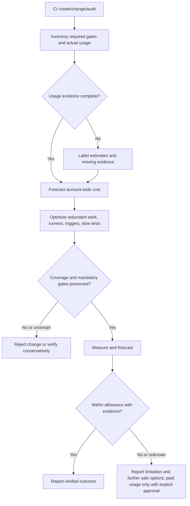

# Code quality setup

## Formatter automation model

The repository formatter runs across three layers (obligation:
`engineering-standards`):

1. Editor/agent edit flows format in write mode immediately after
   creating or modifying formatter-managed files.
2. Pre-commit hooks format changed files in write mode and stage
   the result.
3. CI runs formatter checks in check-only mode and fails on drift,
   without writing, committing, or otherwise mutating the repo.

## GitHub Actions runtime currency

Keeping JavaScript actions on GitHub's current GA Node major
(obligation: `engineering-standards`) uses this migration
procedure:

- During a window where the runner default is an older major, set
  GitHub's documented workflow-scope opt-in variable. For the
  Node 20 to Node 24 migration, set
  `FORCE_JAVASCRIPT_ACTIONS_TO_NODE24: "true"` under top-level
  workflow `env`.
- Once the newer major becomes the runner default, remove the
  opt-in variable in the same change set that updates the workflow.

## CI cost optimization

Procedure for the CI cost obligation in `engineering-standards`:

1. Establish required checks, target environments, branch protection and release
   gates. Inventory workflows, triggers, jobs, attempts, and verification commands.
2. Read actual job durations, run counts, conclusions and billing data if
   accessible. Use current official pricing, billing granularity and included
   allowance; distinguish wall-clock latency from aggregate billable usage.
   Forecast account-wide monthly consumption, including other repositories.
   If data is incomplete, label estimates, assumptions, and unverified scope;
   never treat missing usage as zero or claim allowance compliance without evidence.
3. Identify duplicate checks, setup and dependency installs, redundant triggers,
   and expensive jobs. Prefer compatible lower-cost runners, lockfile-keyed
   dependency caches when beneficial, safe cancellation of superseded runs,
   and impact-based selection only with conservative fallback for unknown impact.
4. Profile slow tests and remove unnecessary waits, process launches or fixture
   setup without changing their assertions or isolation. Retain native OS
   verification for OS-dependent behavior; use isolated runners where needed.
5. Compare before/after verification inventory, environments, executed and
   skipped cases, and defect-detection capability. Confirm mandatory checks
   cannot be silently skipped or marked successful without execution.
6. Measure the resulting aggregate billable time and projected monthly usage.
   If the forecast exceeds the allowance, propose further safe reductions;
   obtain user approval before adopting paid usage. Do not change billing
   settings or retry billing-blocked jobs as a workaround.



Documentation contract only (not a new implementation/API):

```ts
type UsageEvidence = { actualBillableUsage: number | null; projectedMonthlyUsage: number | null; complete: boolean; assumptions: string[]; unverifiedScope: string[] };
type VerificationEvidence = { requiredGatesPreserved: boolean; targetEnvironmentsPreserved: boolean; executedAndSkippedCompared: boolean; detectionPreserved: boolean };
```

## Per-language toolchain

Use the standard toolchain for each language in the repository.

### JavaScript / TypeScript (incl. React/Next)

- Format and lint: ESLint + Prettier.
- When configuring Prettier, the agent MUST add and maintain
  `.prettierignore` so generated/build outputs and composed files
  are not formatted/linted as source (e.g., `dist/`, build
  artifacts, and `AGENTS.md` when generated by `compose-agentsmd`).
- Typecheck: `tsc` with strict settings for TS projects.
- Dependency scan: `osv-scanner`. If unsupported, use the package
  manager's audit tooling.

### Python

- Format and lint: Ruff.
- Typecheck: Pyright.
- Dependency scan: pip-audit.

### Go

- Format: gofmt.
- Lint and static analysis: golangci-lint (includes staticcheck).
- Dependency scan: govulncheck.

### Rust

- Format: cargo fmt.
- Lint and static analysis: cargo clippy with warnings as errors.
- Dependency scan: cargo audit.

### Java

- Format: Spotless + google-java-format.
- Lint and static analysis: Checkstyle + SpotBugs.
- Dependency scan: OWASP Dependency-Check.

### Kotlin

- Format: Spotless + ktlint.
- Lint and static analysis: detekt.
- Compiler: enable warnings-as-errors in CI. If impractical, the
  agent MUST get explicit user approval before relaxing.

### C\#

- Format: dotnet format (verify-no-changes in CI).
- Lint and static analysis: enable .NET analyzers; treat warnings
  as errors; enable nullable reference types.
- Dependency scan: `dotnet list package --vulnerable`.

### C++

- Format: clang-format.
- Lint and static analysis: clang-tidy.
- Build: enable strong warnings and treat as errors. Run
  sanitizers (ASan/UBSan) in CI where supported.

### PowerShell

- Format and lint: PSScriptAnalyzer (Invoke-Formatter +
  Invoke-ScriptAnalyzer).
- Runtime: `Set-StrictMode -Version Latest`. Fail fast on errors.
- Tests: Pester when tests exist.
- The agent MUST enforce PSScriptAnalyzer via the repo's standard
  `verify` command or script when PowerShell is used. Findings
  MUST be treated as errors.

### Shell (sh/bash)

- Format: shfmt.
- Lint: shellcheck.

### Dockerfile

- Lint: hadolint.

### Terraform

- Format: terraform fmt -check.
- Validate: terraform validate.
- Lint: tflint.
- Security scan: trivy config.

### YAML

- Lint: yamllint.

### Markdown

- Lint: markdownlint.

## Design and visual accessibility automation

Apply this section to projects with web UI components only.

- The agent MUST enforce automated visual accessibility checks as
  part of the repo-standard `verify` command and CI.
- The agent MUST use route discovery (sitemap, generated route
  lists, or framework route manifests) so newly added pages are
  automatically included.
- The agent MUST validate both light and dark themes when theme
  switching is supported.
- The agent MUST validate at least default, hover, and focus
  states for interactive elements.
- The agent MUST enforce non-text boundary contrast checks across
  all visible UI elements that present boundaries (including
  interactive controls and container-like elements), not only
  predefined component classes.
- The agent MUST use broad DOM discovery with only minimal
  technical exclusions (hidden, zero-size, or non-rendered nodes).
- CI MUST fail on violations. The agent MUST NOT silently ignore
  design regressions.
- If temporary exclusions are unavoidable, the agent MUST keep
  them narrowly scoped, MUST document the rationale, and MUST
  remove them promptly.

## Security baseline

- The agent MUST require dependency vulnerability scanning
  appropriate to the ecosystem (SCA) for merges. If unavailable,
  the agent MUST report the limitation and get explicit user
  approval.
- The agent MUST enable GitHub secret scanning and remediate
  findings. The agent MUST NOT commit secrets. If GitHub secret
  scanning is unavailable, the agent MUST add a repo-local secret
  scanner.
- The agent MUST enable CodeQL code scanning for supported
  languages. If unavailable, the agent MUST use the best
  alternative for that ecosystem.
